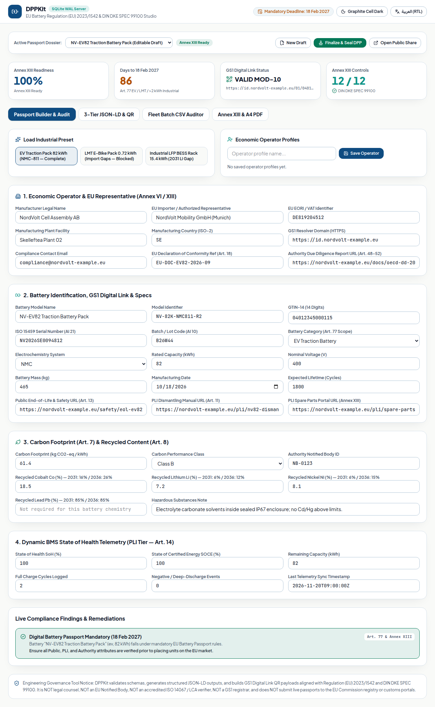
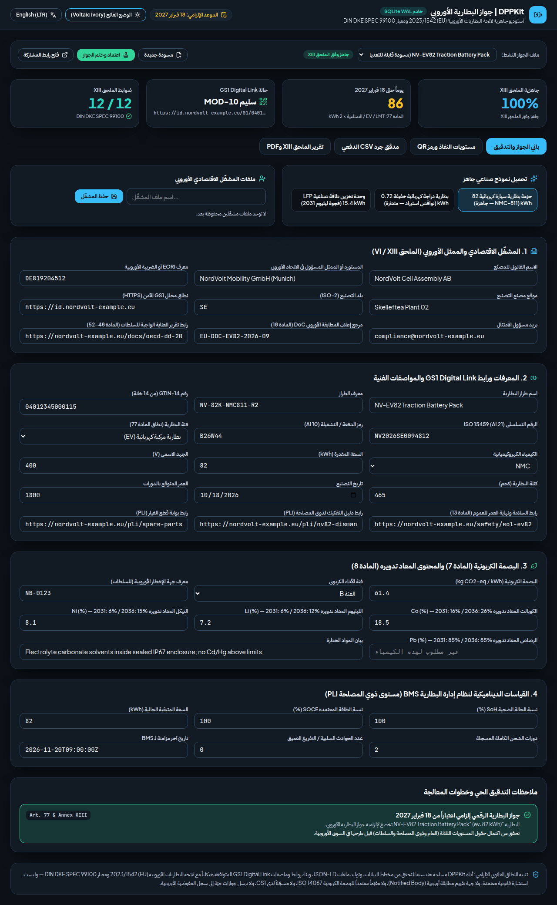
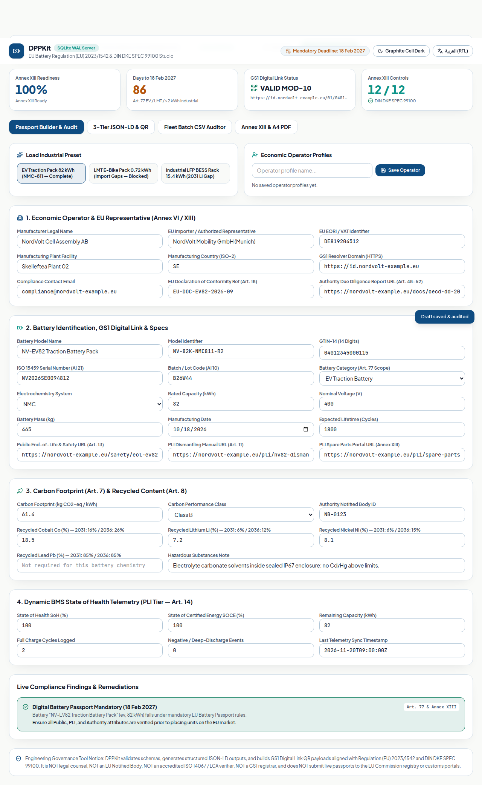
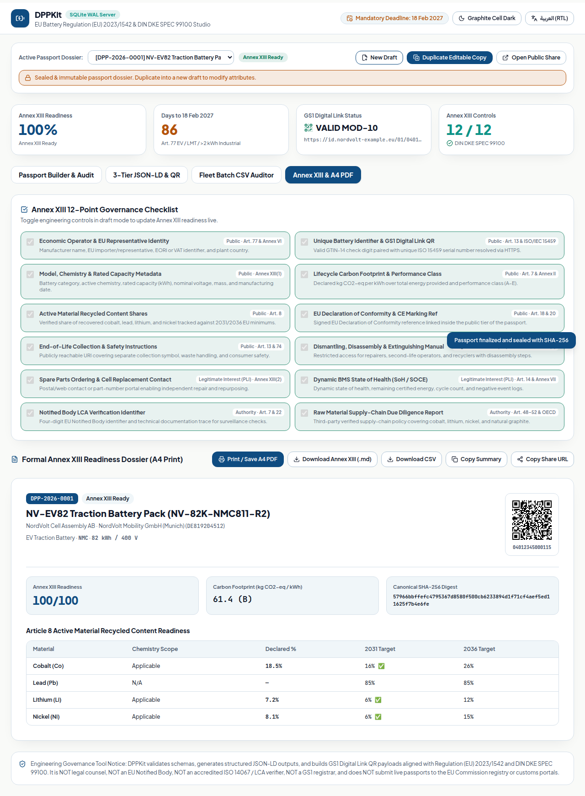
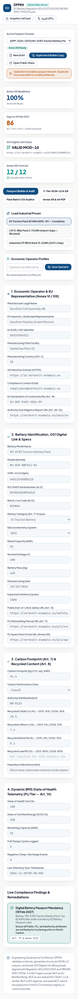
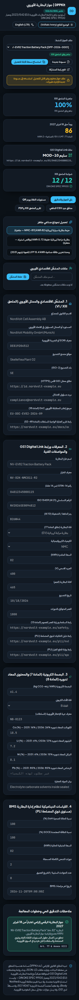

# DPPKit | جواز البطارية الأوروبي

[](https://github.com/manea/dppkit/actions/workflows/ci.yml)
[](LICENSE)
**EU Battery Regulation `(EU) 2023/1542` & `DIN DKE SPEC 99100` Digital Battery Passport Studio**

A zero-infrastructure, bilingual (**EN LTR / AR RTL**) engineering studio to validate battery passport schemas, verify **GTIN-14 (Mod-10)** & **GS1 Digital Link** QR payloads, enforce strict **3-tier (`Public` / `PLI` / `Authority`)** JSON-LD attribute isolation, check **Article 8** chemistry-aware recycled content targets (**2031 / 2036**), and audit bulk battery catalogs offline in the browser or self-hosted via **Node 22 + SQLite WAL**.

> **Mandatory Legal Disclaimer:** DPPKit validates schemas, generates structured JSON-LD outputs, and builds GS1 Digital Link QR payloads aligned with Regulation `(EU) 2023/1542` and `DIN DKE SPEC 99100`. It is **NOT** legal counsel, **NOT** an EU Notified Body, **NOT** an accredited ISO 14067 / LCA carbon-footprint verifier, **NOT** a GS1 registrar, and does **NOT** submit live passports to the EU Commission registry or customs systems.

---

## Regulatory Cutoff: **18 February 2027**
Under **Article 77 & Annex XIII** of Regulation `(EU) 2023/1542`:
- **EV Batteries** — Full Digital Battery Passport mandatory.
- **LMT Batteries** (e-bikes, e-scooters) — Full Digital Battery Passport mandatory.
- **Industrial Batteries > 2 kWh** (including BESS racks) — Full Digital Battery Passport mandatory.
- **Portable & Industrial <= 2 kWh** — Exempt from full Article 77 passport (`Art. 13` QR labeling still applies).

## Key Features
- **GTIN-14 Mod-10 & GS1 Digital Link Builder**: Generates and parses strict HTTPS `https://<domain>/01/<gtin14>/.../21/<serial>` URIs and renders **ISO/IEC 18004 QR SVG** codes client-side or on server.
- **DIN DKE SPEC 99100 Three-Tier Isolation**:
  - `public`: Model specs, carbon footprint class, recycled shares, EU DoC ref, EoL safety URI (**no BMS telemetry, no Notified Body ID**).
  - `pli` (Legitimate Interest): Adds dismantling manual, spare parts portal, and dynamic BMS `SoH / SOCE`.
  - `authority`: Full technical verification (`EORI`, Notified Body ID, OECD due diligence URI, `SHA-256` digest).
- **Chemistry-Aware Article 8 Readiness**: Evaluates `Co` (`16%`/`26%`), `Pb` (`85%`), `Li` (`6%`/`12%`), `Ni` (`6%`/`15%`) relative to active cell chemistry (e.g., LFP automatically marks Cobalt/Nickel as N/A).
- **Fleet Batch CSV Auditor**: Quote-aware CSV parsing + sanitized **UTF-8 BOM** CSV export (formula-injection protected).
- **Dual Storage Architecture ($0 Friendly)**: Runs 100% client-side in `localStorage` on Cloudflare Workers Static Assets, or persists atomically (`DPP-YYYY-0001`, `SHA-256`, `409` locks) on Node 22 `node:sqlite` WAL.

---


## UI Previews

### Workspace — English LTR (`Voltaic Ivory & Nordic Cobalt`)


### Dual-Script Workspace — Arabic RTL (`Graphite Cell Dark`)


### EV Battery Builder & Real-Time Annex XIII Validation


### Sealed EU Battery Passport (`DPP-YYYY-0001`, 12 Controls, GS1 QR & SHA-256)


### Mobile English LTR View (`390x844`)


### Mobile Arabic RTL View (`Graphite Cell Dark`, `390x844`)


---
## Quick Start

### 1. Local Development & Tests
```bash
npm install
npm run typecheck
npm test
npm run build
npm run dev       # Vite UI on http://127.0.0.1:4202
```

### 2. Optional Node 22 + SQLite WAL Server (`:4201`)
```bash
npm run build
npm start         # Serves UI + API on http://127.0.0.1:4201
```

### 3. Deploy Static (`$0` Cloudflare Workers Assets)
```bash
npm run build
npx wrangler deploy
```

### 4. Deploy via Docker Compose
```bash
docker compose up -d --build
```
